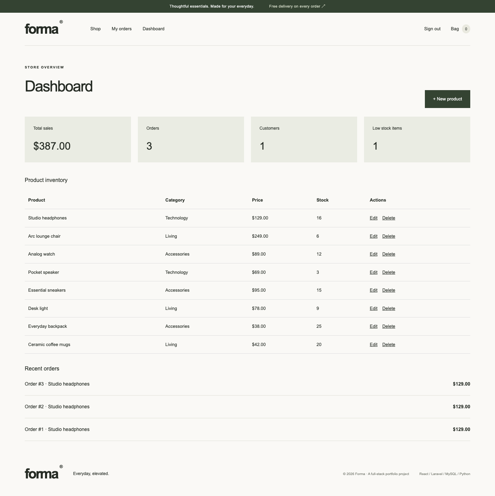

# Forma · Fullstack E-commerce Platform

A modern essentials store built with React, TypeScript, Tailwind CSS, Laravel 12 (PHP 8.4.1+), MySQL, and dependency-free Python analytics. Cookie authentication, searchable catalog, persistent local cart, transactional mock checkout, private order history, and admin inventory management.




## Setup

Requires PHP 8.4.1+, Composer, Node 20.19+ or 22.12+, Python 3, and MySQL 8 (or Docker).

```sh
composer install
npm ci
cp .env.example .env
php artisan key:generate
docker compose up -d --wait
php artisan migrate --seed
npm run build
php artisan serve
```

Open http://127.0.0.1:8000. For frontend development run `npm run dev` in another terminal. An existing MySQL instance works too: update the `DB_*` variables. For a quick SQLite demo, set `DB_CONNECTION=sqlite`, remove `DB_DATABASE` from `.env`, and run `touch database/database.sqlite` before migrating.

Demo accounts: `customer@forma.test` and `admin@forma.test`, password `Portfolio2026!`. Seed data is local/testing only. No real payment is processed; no card details are requested. Product photography is loaded from Unsplash.

## Checks and sales reporting

```sh
php artisan test
npm run build
python3 -m unittest discover -s analytics
php artisan sales:export
python3 analytics/report.py storage/app/sales.csv --output storage/app/report.json
# Sample report without a running database:
python3 analytics/report.py analytics/sample_sales.csv
```

Money uses integer cents. Checkout recalculates prices, locks inventory rows in a database transaction, and rejects insufficient stock. Order items snapshot product names/prices. Customer/admin endpoints require a session; admin access is checked server-side. Passwords are hashed; authentication is rate limited and mutations use Laravel CSRF protection. Cart content is stored locally and revalidated on checkout.

REST endpoints: `GET /api/products?search=`, `POST /api/register`, `POST /api/login`, `POST /api/logout`, `GET /api/user`, `GET /api/orders`, `POST /api/checkout`, `GET /api/admin/dashboard`, and `POST/PUT/DELETE /api/admin/products[/{id}]`. The React app and API share one origin. API errors return JSON when `Accept: application/json` is sent. Login/register/logout rotate the CSRF token; the frontend reloads after those operations.

Production: use HTTPS, set `APP_ENV=production`, `APP_DEBUG=false`, `SESSION_SECURE_COOKIE=true`, unique database credentials, and serve only `public/`. Create admin users through a trusted server-side process; demo credentials are not for deployment.
